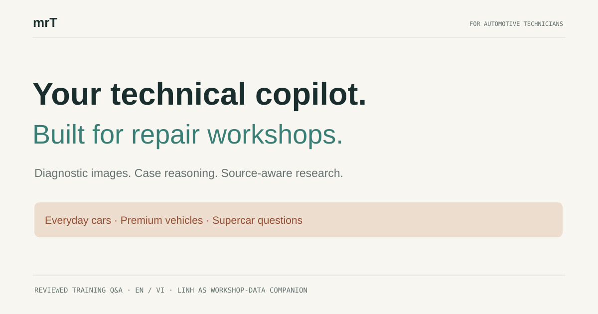
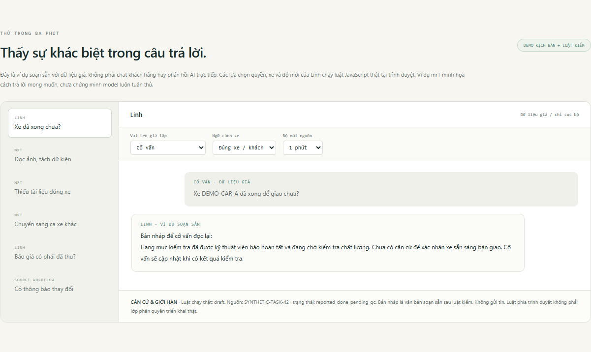
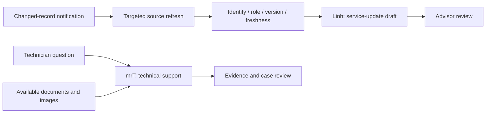

# mrT × Linh

### Two assistants. One workshop workflow.

**mrT helps technicians investigate. Linh helps service advisors explain progress.** This project shows how the two roles connect through vehicle records, source context and explicit limits.

[**Explore the interactive showcase →**](https://tuynguyenautosonly.github.io/mrt-linh/) · [Tiếng Việt](README.vi.md) · [Capabilities & evidence](CAPABILITIES.md) · [Contribute a case](CONTRIBUTING.md)



## Try it in one minute

1. Open the [showcase](https://tuynguyenautosonly.github.io/mrt-linh/). No account or API key.
2. Select **“Is the vehicle ready?”** Toggle the role, vehicle identity and source age. Watch the local rule withhold mismatched context.
3. Explore mrT’s examples: separate image text from a diagnosis, handle a missing model-specific manual, and start a new vehicle case.
4. Try the [companion report checker](https://tuynguyenautosonly.github.io/mrt-linh/report.html): reported completion is not recorded acceptance. Inspect stale updates and conflicting IDs.

The page supports English and Vietnamese. Imported CSV files are processed inside your browser tab, without uploads or local storage.



## What is actually here?

This is a **public, synthetic showcase**, written separately from the private deployment. It is not the deployed agents, a live AI chatbot, a diagnostic product, or a production-ready workshop integration.

| Component | What runs in this repository |
|---|---|
| mrT walkthroughs | Authored scenarios explaining intended technical evidence discipline; no model or OCR calls |
| Linh walkthrough | Executable local role / vehicle / customer / freshness checks, followed by an authored draft |
| Source workflow | An architecture illustration based on maintainer-reviewed deployment records; no source connection |
| Report checker | Dependency-free CSV parser and deterministic row checks, with inspectable references and text export |

**Honesty matters:** technical overclaims have been observed in the private system. Installed rules and passing local tests do not establish consistent model behavior. This repository does not claim that those failures are fully solved. See the [evidence matrix](CAPABILITIES.md).

## Why two roles?

- **mrT / technical assistant:** organize case facts, work with images and available documentation, and support investigation. A document for one platform must not silently become authority for another. No matched procedure means no invented coding/reset sequence.
- **Linh / service advisor assistant:** turn authorized vehicle context into a concise draft for human review. “Technician reported done,” “QC accepted,” “quote complete,” “ready for delivery” and “paid” have different meanings.
- **Shared source workflow:** target changed records, bind the receipt and task set, check source version and observation time, then project only appropriate context.



The architecture describes the project approach. The browser demonstration is not the private integration, and its client-side checks must not be used as real authorization.

## Run locally

Requires Node.js 20+ for tests and Python 3 for the optional static server. No package installation.

```sh
git clone https://github.com/tuynguyenautosonly/mrt-linh.git
cd mrt-linh
npm test
python -m http.server 8097 --bind 127.0.0.1 --directory docs
```

Open `http://127.0.0.1:8097/`. The report sample uses a **fixed synthetic clock**; an imported CSV uses your current local time. Timestamps in the CSV require an explicit timezone.

## Explore the code

- [Interactive examples](docs/showcase.mjs)
- [Synthetic Linh context checks](docs/showcase-engine.mjs)
- [CSV/report engine](docs/engine.mjs)
- [Behavior tests](tests/)
- [Architecture & privacy](ARCHITECTURE.md)
- [Limitations and evidence](CAPABILITIES.md)

## Build with us

Useful feedback: an anonymized edge case, a clearer explanation, an accessibility fix, or a reproducible failure. Please use **invented** IDs and data; do not submit customer records, real vehicle identifiers, private manuals or credentials.

This release focuses on showing the system and inviting technical feedback. There is no sales funnel, paid signup, or production access offered here. Stars are welcome if the ideas are useful; concrete critique is even better.

## License

The newly written public showcase code is [MIT licensed](LICENSE). The license does not cover private deployment code, private datasets, third-party manuals, messaging platforms or model providers.
