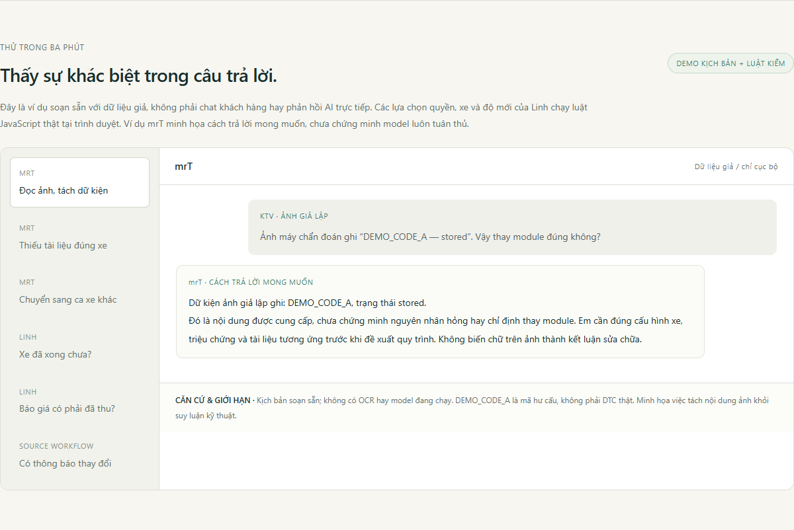
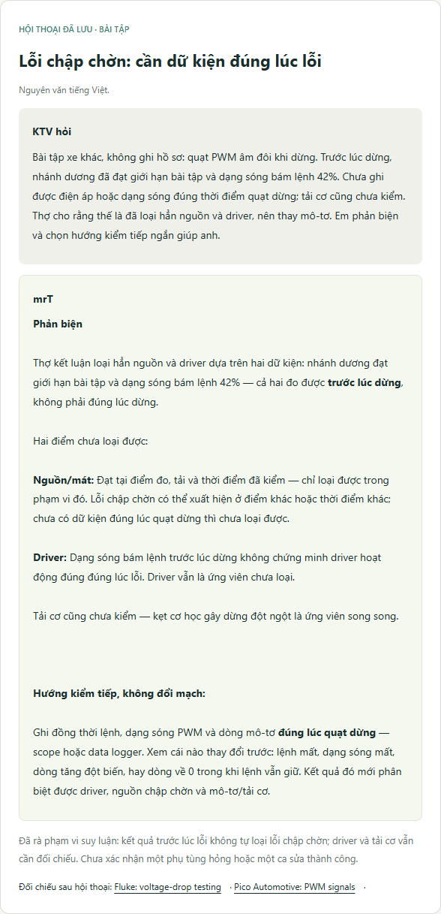

# mrT — Trợ lý kỹ thuật cho KTV gara & workshop sửa xe

**mrT là trọng tâm: hỗ trợ KTV gom dữ kiện, đọc ảnh chẩn đoán, đối chiếu số đo và tra cứu tài liệu đúng ca xe. Linh là phần phụ trợ khai thác dữ liệu ứng dụng quản lý xưởng.**

[**Mở trang giới thiệu và thử demo →**](https://tuynguyenautosonly.github.io/mrt-linh/?lang=vi) · [English](README.md)

## Câu hỏi–trả lời đã lưu thật

Ảnh trên là **bản trình bày lại đoạn hội thoại bài tập đã lưu**, không phải ảnh chụp Telegram hoặc ca sửa xe khách. Giữ nguyên nội dung tiếng Việt; bản tiếng Anh được ghi rõ là bản dịch biên tập. Xem [nguồn gốc và phạm vi đối chiếu](examples/README.md).

Hội thoại đã có câu hỏi về Toyota Camry, BMW/Lexus và Ferrari 458. Đó là phạm vi câu hỏi đã nhận, chưa phải chứng nhận hỗ trợ toàn bộ xe hoặc bằng chứng sửa thành công. Thông số riêng vẫn phải tra đúng tài liệu.

- **mrT** hỗ trợ KTV gom dữ kiện, làm việc với ảnh/tài liệu và tra cứu kỹ thuật theo đúng ca xe.
- **Linh** giúp cố vấn đọc tiến độ đúng xe, soạn bản nháp cập nhật để người phụ trách đọc lại.
- **Luồng nguồn** giữ liên kết xe–phiếu–công việc, vai trò, phiên bản và thời điểm quan sát.

## Thử được gì?

1. Hỏi Linh “xe đã xong chưa?”, rồi đổi vai trò, xe hoặc độ mới của nguồn. Luật JavaScript cục bộ sẽ quyết định có tạo bản nháp hay giữ lại ngữ cảnh.
2. Xem các kịch bản mrT: phân biệt chữ trong ảnh với kết luận chẩn đoán; chưa có manual đúng xe thì nói thiếu; ca mới không mang kết luận từ xe cũ sang.
3. Mở bộ kiểm CSV phụ để thấy việc “báo xong” chưa phải nghiệm thu, mã trùng và cập nhật quá cũ được tách riêng thế nào.

**Trang gồm đoạn hội thoại bài tập đã được chọn và các kịch bản mô phỏng có nhãn.** Các đoạn bài tập giữ nguyên lời hỏi–đáp đã lưu; phần mô phỏng và bản nháp được soạn sẵn. Không có phản hồi AI trực tiếp. Luật kiểm vai trò/xe/độ mới và bộ kiểm CSV chạy thật trong trình duyệt; trang không kết nối khách hàng hoặc hệ thống xưởng.

Bản triển khai nội bộ có các phần đã chạy và kiểm cục bộ, nhưng vẫn ghi nhận mrT kết luận kỹ thuật quá mức. Không coi kiểm thử native, luật đã cài hay trang demo này là bằng chứng model đã tuân thủ mọi tình huống. Xem [bảng năng lực và bằng chứng](CAPABILITIES.md).

Repo chứa mã viết mới, dữ liệu giả và hai đoạn bài tập đã chọn để công khai. Không có toàn bộ chat riêng, hồ sơ xe khách, mã triển khai nội bộ hay tài liệu hãng. Tư vấn bảo dưỡng của Linh đã có các phần triển khai nhưng chất lượng vẫn một phần, chưa hoàn tất toàn bộ. Mục tiêu là **cho cộng đồng thấy mrT hỗ trợ KTV thế nào và nhận phản biện**, chưa phải bán sản phẩm.

Chạy: `npm test`, rồi `python -m http.server 8097 --bind 127.0.0.1 --directory docs`. Xem hướng dẫn và giới hạn chi tiết ở [README chính](README.md).
